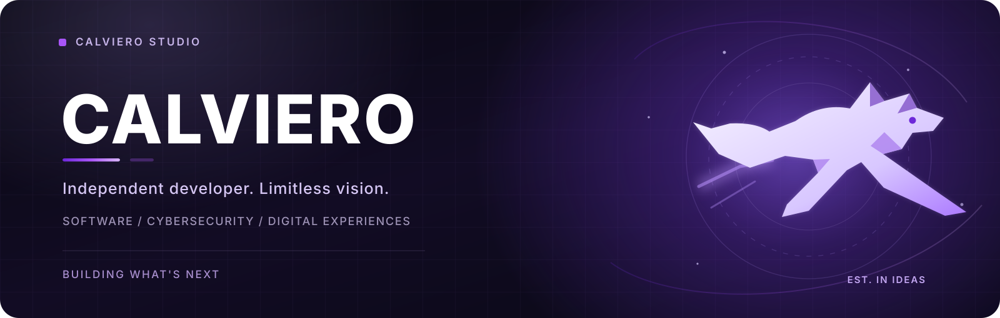
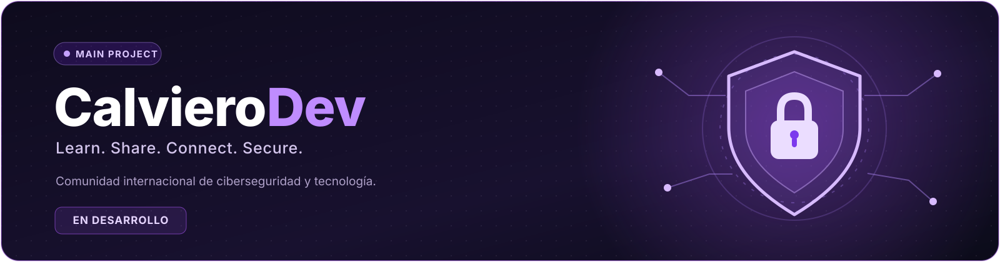

<div align="center">

<!-- ═══════════════════════════ CALVIERO / COVER ═══════════════════════════ -->



<br />

<a href="https://readme-typing-svg.demolab.com">
  
</a>

<br />

**Desarrollo software. Diseño experiencias. Construyo ideas.**

<br />

<a href="https://github.com/Calviero"></a>
<a href="https://calvierodev.xyz/"></a>
<a href="https://github.com/Calviero?tab=repositories"></a>

<br />
<br />


</div>


## `01` · Quién está detrás del código

Soy **Calviero**, desarrollador independiente y creador de **Calviero Studio**, mi espacio personal de desarrollo de software, productos digitales y exploración tecnológica.

Me interesa construir tecnología que no solo funcione, sino que también **se sienta intuitiva, tenga identidad y esté diseñada con criterio**. Trabajo en todo el proceso creativo: desde una idea inicial hasta la experiencia que encuentra quien la utiliza.

Mi enfoque combina tres disciplinas que considero inseparables:

<table>
<tr>
<td width="33%" align="center">
<h3><code>&lt;/&gt;</code> DESARROLLO</h3>
<p>Interfaces, aplicaciones y soluciones digitales concebidas para evolucionar.</p>
</td>
<td width="33%" align="center">
<h3>◈ CIBERSEGURIDAD</h3>
<p>Seguridad, privacidad y buenas prácticas integradas desde el diseño.</p>
</td>
<td width="33%" align="center">
<h3>✧ EXPERIENCIA</h3>
<p>Diseño visual, accesibilidad y atención a cada detalle de interacción.</p>
</td>
</tr>
</table>

> **Una visión independiente. Un creador. Infinitas posibilidades.**


## `02` · El proyecto que define mi visión

<div align="center">

<a href="https://calvierodev.xyz/"></a>

<br />

<a href="https://calvierodev.xyz/"></a>


</div>

### ¿Qué es CalvieroDev?

**[CalvieroDev](https://calvierodev.xyz/)** es una plataforma comunitaria enfocada en la **ciberseguridad, la tecnología y el intercambio de conocimiento**. Está concebida como un lugar para personas que quieren aprender, participar en conversaciones técnicas, descubrir nuevas perspectivas y construir comunidad.

No busca ser únicamente un sitio de contenido: la visión es crear una experiencia **centrada en las personas, en las conversaciones y en el aprendizaje colaborativo**.

<table>
<tr>
<td width="50%"><strong>COMUNIDAD PRIMERO</strong><p>Foros, discusiones, conexiones y espacios donde cada aportación tenga valor.</p></td>
<td width="50%"><strong>APRENDIZAJE CONTINUO</strong><p>Preguntas, guías, recursos e intercambio responsable de conocimiento técnico.</p></td>
</tr>
<tr>
<td><strong>SEGURIDAD COMO PRINCIPIO</strong><p>Privacidad, moderación, protección de cuentas y convivencia responsable.</p></td>
<td><strong>UNA EXPERIENCIA PROPIA</strong><p>Identidades personalizables, navegación clara y una interfaz cuidada.</p></td>
</tr>
</table>

<details>
<summary><b>Explorar la visión funcional de CalvieroDev</b></summary>
<br />

Las siguientes áreas describen la **visión del producto y las funcionalidades contempladas**. Su inclusión aquí no implica que todas estén disponibles actualmente.

| Área | Experiencia prevista |
|:--|:--|
| **Comunidad** | Categorías, publicaciones, debates, menciones y reacciones. |
| **Comunicación** | Chats y conversaciones privadas con controles de privacidad. |
| **Identidad** | Perfiles, avatares, banners e insignias personalizables. |
| **Participación** | Reputación, contribuciones y reconocimiento de miembros. |
| **Moderación** | Roles, permisos, reportes y herramientas de gestión. |
| **Seguridad** | Protección de cuentas y mecanismos contra abusos. |
| **Accesibilidad** | Experiencia adaptable a escritorio y dispositivos móviles. |
| **Alcance** | Una comunidad con vocación internacional. |

</details>

<div align="center">

**Un foro para compartir conocimiento. Una comunidad para impulsar el futuro.**

[**Conocer CalvieroDev ↗**](https://calvierodev.xyz/)

</div>


## `03` · Tecnologías y herramientas

<div align="center">

**LENGUAJES Y DESARROLLO**


<br />
<br />

**INFRAESTRUCTURA, DATOS Y HERRAMIENTAS**


<br />
<br />


</div>

<br />

Estas son tecnologías presentes en mi entorno de trabajo e intereses técnicos; **no representan necesariamente la arquitectura utilizada en cada proyecto**.


## `04` · Cómo entiendo el desarrollo

```text
CALVIERO / DEVELOPMENT PRINCIPLES
────────────────────────────────────────────────────────
  01    Think clearly.       Resolver el problema real.
  02    Build thoughtfully.  Diseñar con intención.
  03    Secure by design.    Considerar la seguridad desde el inicio.
  04    Refine relentlessly. Mejorar hasta en los pequeños detalles.
  05    Keep evolving.       Aprender, iterar y volver a construir.
────────────────────────────────────────────────────────
```

Para mí, un buen proyecto necesita más que código: requiere propósito, coherencia y una experiencia que invite a seguir utilizándolo. Por eso doy prioridad a la **claridad visual**, la **arquitectura mantenible**, la **seguridad** y el **aprendizaje constante**.


## `05` · GitHub / actividad y estadísticas

<div align="center">

<!-- Los servicios externos de estadísticas pueden experimentar límites o interrupciones. -->

<a href="https://github.com/Calviero">
  
</a>
<a href="https://github.com/Calviero">
  
</a>

<br />

<a href="https://github.com/Calviero?tab=repositories">
  
</a>

<br />
<br />

<sub>Las estadísticas se generan automáticamente a partir de la actividad pública disponible en GitHub y pueden depender de servicios externos.</sub>

</div>


## `06` · Hacia dónde estoy construyendo

No se trata de lanzar proyectos por lanzarlos. Se trata de desarrollar una plataforma con **identidad**, utilidad real y capacidad de crecer a medida que su comunidad evolucione.

```text
                  IDEA
                   │
                   ▼
             DESIGN SYSTEM
                   │
                   ▼
              DEVELOPMENT
                   │
                   ▼
          SECURITY + EXPERIENCE
                   │
                   ▼
           COMMUNITY + FEEDBACK
                   │
                   └──────────► IMPROVE. REPEAT.
```

**Mi prioridad actual:** seguir dando forma a **CalvieroDev**, mejorar su experiencia comunitaria y consolidar las bases técnicas para su evolución.


## `07` · Explora y conecta

<div align="center">

<a href="https://calvierodev.xyz/">
  
</a>
<a href="https://github.com/Calviero?tab=repositories">
  
</a>

<br />
<br />

### Not everything needs to exist. The right ideas do.

*«La ciberseguridad comienza con el conocimiento»*

**CALVIERO STUDIO**

<sub>Independent software · Cybersecurity · Digital craft</sub>

<br />
<br />


</div>
