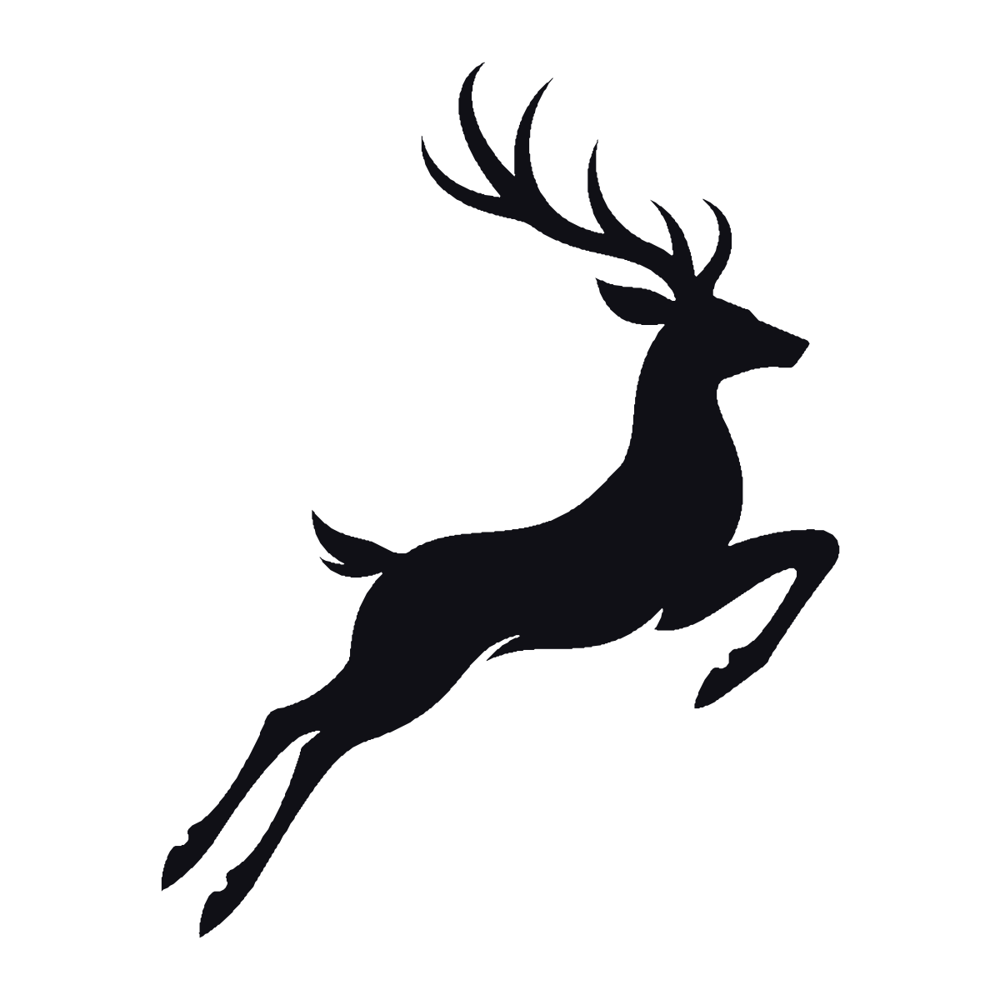

<!--
  CALVIERO · GitHub Profile
  Identidad: Calviero / Calviero Studio
  Diseño minimalista, monocromático y violeta.
  El ciervo es el logotipo original, con fondo transparente.
-->

  <a href="https://studio.calvierodev.xyz/" title="Visitar Calviero Studio">
    <picture>
      <source media="(prefers-color-scheme: dark)" srcset="./assets/calviero-deer-white.svg" />
      <source media="(prefers-color-scheme: light)" srcset="./assets/calviero-deer-dark.svg" />
      
    </picture>
  </a>

  <h1>CALVIERO</h1>

  

    <strong>Independent Developer</strong>
    &nbsp;·&nbsp;
    <strong>Founder of Calviero Studio</strong>
  

  
Software Development &nbsp;•&nbsp; Cybersecurity &nbsp;•&nbsp; Digital Experiences

  

    

  
  
  

    

  

---

### 01 — Detrás del código

Soy **Calviero**, fundador y único desarrollador de **[Calviero Studio](https://studio.calvierodev.xyz/)**, mi estudio personal e independiente dedicado a convertir ideas en productos digitales.

Me interesa construir software que no solo funcione, sino que también tenga **identidad, propósito y una experiencia de usuario cuidada**. Participo en todo el proceso: planificación, diseño, desarrollo, seguridad, implementación y evolución de cada proyecto.

> **Mi filosofía:** crear con independencia, aprender constantemente y hacer que cada detalle cuente.

---

### 02 — Mi ecosistema

<table>
  <tr>
    <td width="50%" valign="top">
      <h3><a href="https://studio.calvierodev.xyz/">Calviero Studio ↗</a></h3>
      
<strong>La identidad detrás de lo que construyo.</strong>

      
Mi estudio independiente para el desarrollo de software, las experiencias web y la exploración de soluciones tecnológicas con un enfoque en calidad, diseño y seguridad.

      
<a href="https://studio.calvierodev.xyz/"><strong>Visitar el estudio →</strong></a>

    </td>
    <td width="50%" valign="top">
      <h3><a href="https://calvierodev.xyz/">CalvieroDev ↗</a></h3>
      
<strong>Mi proyecto oficial y comunidad de ciberseguridad.</strong>

      
Un espacio internacional para aprender, publicar, compartir conocimientos, conectar con otras personas y crecer juntos alrededor de la seguridad informática.

      
<a href="https://calvierodev.xyz/"><strong>Explorar la comunidad →</strong></a>

    </td>
  </tr>
</table>

  
  
  
  

---

### 03 — Cómo entiendo la tecnología

|  | Lo que me importa |
|:--|:--|
| **01 · Software** | Crear soluciones funcionales, mantenibles y bien estructuradas. |
| **02 · Seguridad** | Considerar la protección, la privacidad y las buenas prácticas desde el diseño. |
| **03 · Experiencia** | Cuidar la claridad, la accesibilidad, el rendimiento y los pequeños detalles. |
| **04 · Comunidad** | Facilitar espacios donde las personas puedan aprender, enseñar y colaborar. |

---

### 04 — Tecnologías y herramientas

  
<strong>Lenguajes</strong>

  
  
  

  
<strong>Interfaces y desarrollo web</strong>

  
  
  
  

  
<strong>Datos, infraestructura y seguridad</strong>

  
  
  
  
  

---

### 05 — Mi actividad en GitHub

  <picture>
    <source media="(prefers-color-scheme: dark)" srcset="https://github-readme-stats.vercel.app/api?username=Calviero&amp;show_icons=true&amp;hide_border=true&amp;bg_color=00000000&amp;title_color=A78BFA&amp;icon_color=A78BFA&amp;text_color=D8D3E0&amp;locale=es" />
    <source media="(prefers-color-scheme: light)" srcset="https://github-readme-stats.vercel.app/api?username=Calviero&amp;show_icons=true&amp;hide_border=true&amp;bg_color=00000000&amp;title_color=6D28D9&amp;icon_color=7C3AED&amp;text_color=292436&amp;locale=es" />
    
  </picture>

  <picture>
    <source media="(prefers-color-scheme: dark)" srcset="https://github-readme-stats.vercel.app/api/top-langs/?username=Calviero&amp;layout=compact&amp;hide_border=true&amp;bg_color=00000000&amp;title_color=A78BFA&amp;text_color=D8D3E0&amp;locale=es" />
    <source media="(prefers-color-scheme: light)" srcset="https://github-readme-stats.vercel.app/api/top-langs/?username=Calviero&amp;layout=compact&amp;hide_border=true&amp;bg_color=00000000&amp;title_color=6D28D9&amp;text_color=292436&amp;locale=es" />
    
  </picture>

   

  <picture>
    <source media="(prefers-color-scheme: dark)" srcset="https://streak-stats.demolab.com?user=Calviero&amp;locale=es&amp;hide_border=true&amp;background=00000000&amp;ring=A78BFA&amp;fire=8B5CF6&amp;currStreakLabel=A78BFA&amp;sideLabels=D8D3E0&amp;dates=AAA2B2" />
    <source media="(prefers-color-scheme: light)" srcset="https://streak-stats.demolab.com?user=Calviero&amp;locale=es&amp;hide_border=true&amp;background=00000000&amp;ring=6D28D9&amp;fire=7C3AED&amp;currStreakLabel=6D28D9&amp;sideLabels=292436&amp;dates=5B5267" />
    
  </picture>

---

### 06 — Conectemos

  
¿Te interesa el desarrollo de software, la ciberseguridad o la creación de comunidades tecnológicas?

  <a href="https://studio.calvierodev.xyz/"><strong>Calviero Studio</strong></a>
  &nbsp;·&nbsp;
  <a href="https://calvierodev.xyz/"><strong>CalvieroDev</strong></a>
  &nbsp;·&nbsp;
  <a href="https://github.com/Calviero"><strong>GitHub</strong></a>

    

  <strong>Código con propósito. Tecnología con visión.</strong>

  
© Calviero Studio · Diseñado y desarrollado de forma independiente por Calviero.

